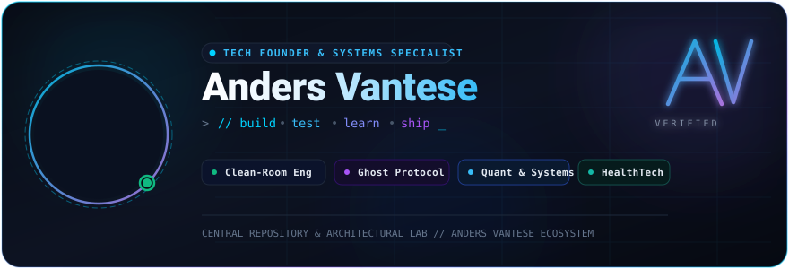
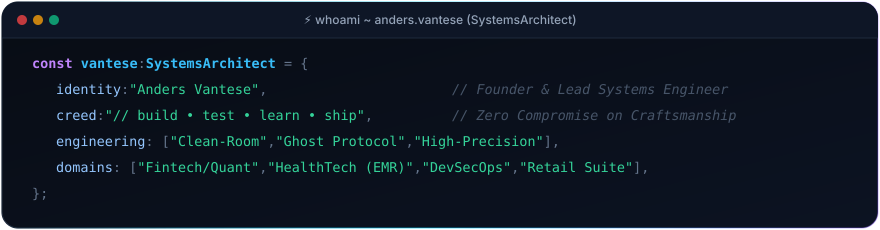
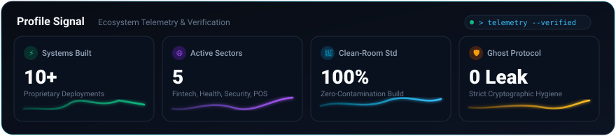
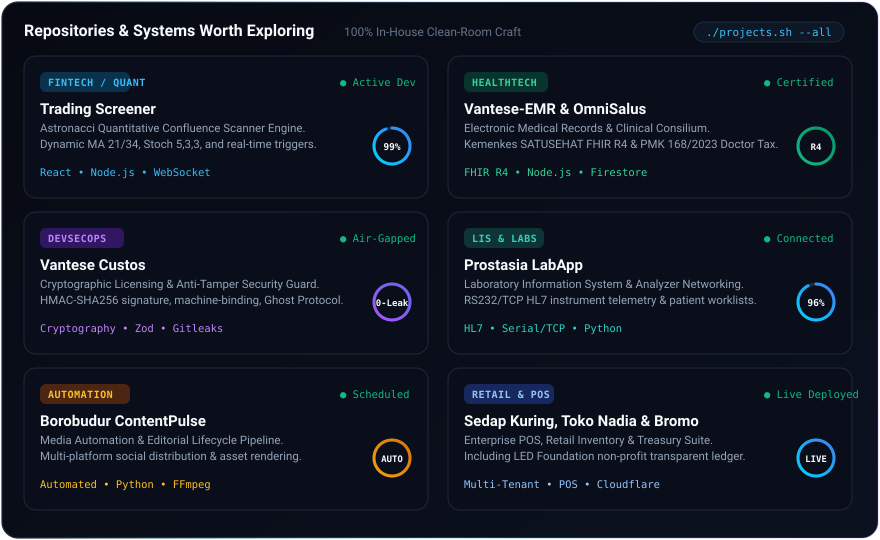
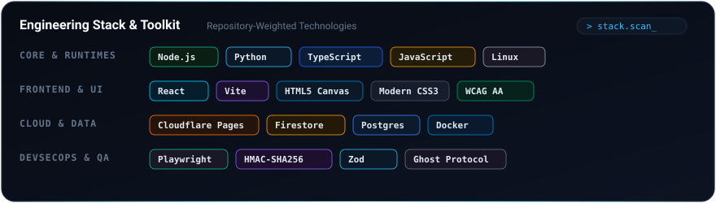
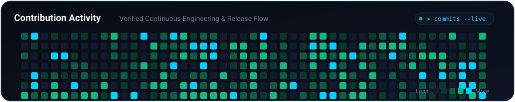
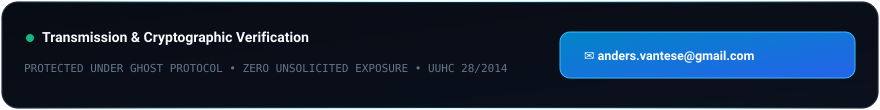

<div align="center">

  <!-- ==================== HERO BANNER ==================== -->
  

  <br/><br/>

  <!-- ==================== WHOAMI CODE BLOCK ==================== -->
  

  <br/><br/>

  <!-- ==================== PROFILE SIGNAL METRICS ==================== -->
  

  <br/><br/>

  <!-- ==================== IN-HOUSE PROJECTS BENTO GRID ==================== -->
  

  <br/><br/>

  <!-- ==================== TECH STACK & TOOLBOX ==================== -->
   stack.scan_ - Engineering Stack &amp; Toolkit" width="100%" />

  <br/><br/>

  <!-- ==================== CONTRIBUTION ACTIVITY HEATMAP ==================== -->
  

  <br/><br/>

  <!-- ==================== FOOTER TRANSMISSION ==================== -->
  <a href="mailto:anders.vantese@gmail.com">
    
  </a>

</div>

<br/>

---

### 🏛️ The Anders Vantese Ecosystem Architecture

> *A consolidated portfolio of in-house enterprise engines, quantitative frameworks, and clinical ecosystems engineered with 100% Clean-Room precision and zero external code contamination.*

<div align="center">
  <code>🔒 Proprietary In-House IP • Private Enterprise Repositories • Ghost Protocol Enforced</code>
</div>

<br/>

```
anders-vantese-ecosystem/
├── 📈 01-fintech-and-quant/
│   └── Trading Screener        # Astronacci Quantitative Confluence Scanner (Dynamic MA 21/34, Stoch 5,3,3)
├── 🏥 02-healthtech-and-clinical/
│   ├── Vantese-EMR             # Electronic Medical Records, SATUSEHAT FHIR R4 & PMK 168/2023 Doctor Tax
│   ├── OmniSalus               # Comprehensive Clinic & Hospital Operations ERP Platform
│   ├── Vantese Medical Consilium # Clinical Decision Support & Medical Advisory Suite
│   └── Prostasia LabApp        # Laboratory Information System (LIS) & Instrument HL7 Telemetry
├── 🛡️ 03-devsecops-and-security/
│   └── Vantese Custos          # HMAC-SHA256 Cryptographic Licensing, Machine-Binding & Ghost Protocol
├── ⚡ 04-automation-and-media/
│   └── Borobudur ContentPulse  # Multi-Tier Editorial Publishing Lifecycle & Media Automation Pipeline
└── 🏢 05-enterprise-client-deployments/
    ├── Sedap Kuring            # Restaurant Point of Sale, Kitchen Display & Order Fulfillment Engine
    ├── Toko Nadia              # Multi-Branch Retail Inventory, POS & Real-Time Cash Flow Matrix
    ├── Kas Bromo Lippo Ladies  # Community Treasury, Ledger Verification & Transparency Accounting
    └── LED Foundation          # Non-Profit Foundation Governance, Operations & Ledger System
```

---

### 🛡️ Engineering & Compliance Directives
* **Clean-Room Standard:** Every line of application logic is engineered from first principles (*zero code contamination*).
* **Ghost Protocol:** Strict operational hygiene, 0 secret leaks, repository segregation, and private credential isolation.
* **Financial & Data Precision:** Integer-safe arithmetic (`Math.round()` peniadaan floating-point creep) and UTF-8 BOM sanitization for audit readiness.
* **Legal Protection:** Proprietary code covered under Indonesian Copyright Law (*UU Hak Cipta No. 28/2014 Pasal 40 &amp; 113*).

<div align="center">
  <sub>© Anders Vantese Ecosystem. All rights reserved. Encrypted transmission: <a href="mailto:anders.vantese@gmail.com">anders.vantese@gmail.com</a></sub>
</div>
